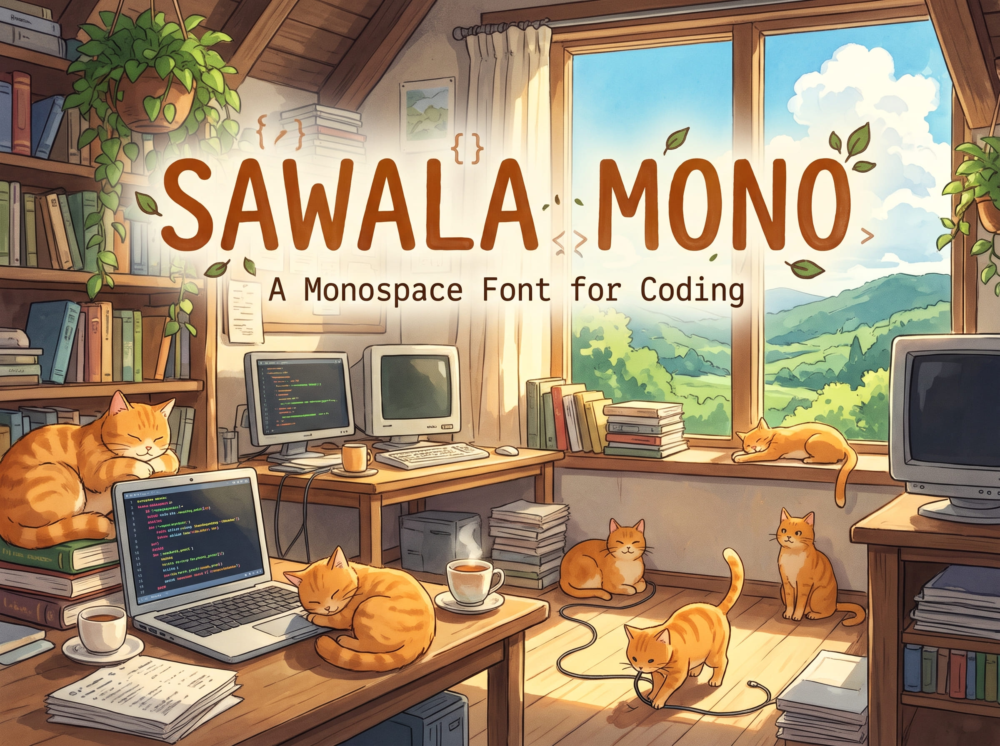

# Sawala Mono
<!-- markdownlint-disable  -->
[](https://github.com/Iosevka-Mayukai/sawala-mono-dev/actions/workflows/build.yml)
[](https://scripts.sil.org/OFL)
[](https://github.com/Iosevka-Mayukai/sawala-mono-dev)
<!-- Live public release badge (enable once repository visibility is changed to public):
[](https://github.com/Iosevka-Mayukai/sawala-mono-dev/releases)
-->



A clean, ergonomic, and highly legible coding font custom-built on top of [Iosevka](https://github.com/be5invis/Iosevka), crafted specifically for focused programming sessions, code reviews, and modern terminal environments.

---

## Table of Contents

- [Philosophy & Story Behind the Name](#philosophy--story-behind-the-name)
- [Font Variants](#font-variants)
- [Installation](#installation)
  - [Pre-built Binaries (GitHub Releases)](#pre-built-binaries-github-releases)
  - [Platform Installation Steps](#platform-installation-steps)
- [Configuration](#configuration)
  - [Visual Studio Code / VSCodium](#visual-studio-code--vscodium)
  - [JetBrains IDEs (IntelliJ IDEA, WebStorm, PyCharm)](#jetbrains-ides-intellij-idea-webstorm-pycharm)
  - [Neovim / Neovide](#neovim--neovide)
  - [Alacritty](#alacritty)
  - [Kitty](#kitty)
  - [WezTerm](#wezterm)
  - [Windows Terminal](#windows-terminal)
- [Building from Source](#building-from-source)
  - [Prerequisites](#prerequisites)
  - [Method A: GitHub Actions on Your Fork (Automated Cloud CI)](#method-a-github-actions-on-your-fork-automated-cloud-ci)
  - [Method B: Generating Nerd Font (Sawala Mono NF) on Your Fork](#method-b-generating-nerd-font-sawala-mono-nf-on-your-fork)
  - [Method C: Containerized Docker Build (Recommended)](#method-c-containerized-docker-build-recommended)
  - [Method D: Native Local Build](#method-d-native-local-build)
- [Architecture & Customization](#architecture--customization)
- [License & Acknowledgments](#license--acknowledgments)

---

## Philosophy & Story Behind the Name

**Sawala Mono** derives its identity from the intersection of regional cultural heritage and modern software engineering practices:

- **Developer-Centric Philosophy:** In the **Sundanese** language, ***sawala*** means *discussion*, *deliberation*, or *intellectual exchange*. In modern software engineering, code is written not merely for compilers, but primarily for humans to read, review, and reason about—through pull requests, peer reviews, pair programming, and architectural RFCs. **Sawala Mono** embodies this collaborative spirit by delivering uncompromising legibility so ideas and logic flow effortlessly.
- **Global Phonetic Harmony:** While rooted in traditional Sundanese vocabulary, its open-syllable phonetics (`Sa-wa-la`) make it smooth and natural to pronounce worldwide alongside timeless monospace staples like *Iosevka* and *Cascadia*.
- **Clean & Distinct Namespace:** Designed as a conflict-free, first-class typeface across operating systems, package managers, and text editors.

---

## Font Variants

| Variant            | Description                                                                       | Recommended Environments                              |
| :----------------- | :-------------------------------------------------------------------------------- | :---------------------------------------------------- |
| **Sawala Mono**    | Standard variant with rich programming ligatures (`=>`, `!==`, `->`, `::`, etc.). | Modern IDEs (VS Code, JetBrains IntelliJ / WebStorm). |
| **Sawala Mono NL** | *No Ligatures* variant for strict symbolic separation.                            | Developers preferring literal operator glyphs.        |
| **Sawala Mono NF** | *Nerd Font* patched variant featuring full Powerline and developer icons.         | Terminal emulators, Neovim, Tmux, Starship prompt.    |

---

## Installation

### Pre-built Binaries (GitHub Releases)

1. Download the latest release `.zip` archive from the [GitHub Releases](https://github.com/Iosevka-Mayukai/sawala-mono-dev/releases) page.
2. Extract the downloaded archive.
3. Follow the installation steps below for your operating system.

### Platform Installation Steps

- **Windows**:
  - Select all `.ttf` files $\to$ Right-click $\to$ Select **"Install for all users"** (recommended on Windows 10/11 to avoid per-user permission issues in Java runtimes and JetBrains IDEs).
- **macOS**:
  - Open **Font Book** (`Cmd + Space` $\to$ `Font Book`).
  - Drag and drop the extracted `.ttf` files into the Font Book window.
- **Linux**:
  - Copy the `.ttf` files to your user fonts directory and refresh the font cache:
    ```bash
    mkdir -p ~/.local/share/fonts/SawalaMono
    cp *.ttf ~/.local/share/fonts/SawalaMono/
    fc-cache -f -v
    ```

---

## Configuration

### Visual Studio Code / VSCodium

Add the following configuration to your `settings.json`:

```json
{
  "editor.fontFamily": "'Sawala Mono', monospace",
  "editor.fontLigatures": true,
  "editor.fontSize": 14,
  "editor.lineHeight": 1.5
}
```

> [!TIP]
> If you are using the **Sawala Mono NL** (*No Ligatures*) variant, set `"editor.fontLigatures": false`.

### JetBrains IDEs (IntelliJ IDEA, WebStorm, PyCharm)

1. Open **Settings / Preferences** (`Ctrl + Alt + S` on Windows/Linux, `Cmd + ,` on macOS).
2. Navigate to **Editor** $\to$ **Font**.
3. Set **Font** to `Sawala Mono`.
4. Ensure **Enable ligatures** is checked (or unchecked if using `Sawala Mono NL`).
5. Recommended font size: `13.5` or `14` with line spacing `1.2`–`1.3`.

### Neovim / Neovide

For Neovim GUI clients (such as Neovide), configure your `init.lua`:

```lua
-- init.lua (Neovim GUI / Neovide)
vim.o.guifont = "Sawala Mono:h14"
```

### Alacritty

Add to your `alacritty.toml`:

```toml
[font.normal]
family = "Sawala Mono"
style = "Regular"

[font.bold]
family = "Sawala Mono"
style = "Bold"

[font.italic]
family = "Sawala Mono"
style = "Italic"

[font]
size = 14.0
```

### Kitty

Add to your `kitty.conf`:

```conf
font_family      Sawala Mono
bold_font        auto
italic_font      auto
bold_italic_font auto
font_size        14.0
```

### WezTerm

Add to your `wezterm.lua`:

```lua
local wezterm = require 'wezterm'
local config = wezterm.config_builder()

config.font = wezterm.font('Sawala Mono')
config.font_size = 14.0

return config
```

### Windows Terminal

Add to your `settings.json` under `profiles.defaults`:

```json
"profiles": {
  "defaults": {
    "font": {
      "face": "Sawala Mono",
      "size": 12
    }
  }
}
```

---

## Building from Source

Sawala Mono compiles using containerized Docker runners and the official Iosevka parametric build engine.

### Prerequisites

- [Docker Desktop](https://www.docker.com/) (recommended for isolated, reproducible builds), OR
- [Node.js](https://nodejs.org/) (`>= 16.0.0`), `npm`, and [`ttfautohint`](https://www.freetype.org/ttfautohint/) installed on the host system.

### Method A: GitHub Actions on Your Fork (Automated Cloud CI)

You can build Sawala Mono entirely in the cloud with zero local toolchain setup by running the workflow in your own GitHub fork:

1. **Fork the Repository:**
   Click the **Fork** button at the top right of this repository to create a copy under your personal or organization GitHub account.

2. **Enable GitHub Actions on Your Fork:**
   - By default, GitHub disables Actions workflows on newly forked repositories for security.
   - In your forked repository, navigate to the **Actions** tab.
   - Click the green button: **"I understand my workflows, go ahead and enable them"**.
   - *(Optional for Automated GitHub Releases)* Go to **Settings** $\to$ **Actions** $\to$ **General** $\to$ **Workflow permissions**, select **"Read and write permissions"**, and click **Save**. This allows GitHub Actions to automatically publish release tags and attach packaged ZIP archives.

3. **(Optional) Customize Font Parameters:**
   - Modify glyph designs, weights, or ligation variants in [`private-build-plans.toml`](private-build-plans.toml).
   - Commit and push your changes to your fork's branch.

4. **Trigger the Build:**
   - Go to the **Actions** tab in your forked repository.
   - In the left sidebar, select **Build Sawala Mono Font**.
   - Click the **Run workflow** dropdown button on the right:
     - **Branch**: Select your working branch (e.g. `main` or `dev`).
     - **Variant to build**: `SawalaMono` (or `all` to compile all plans).
     - **Format output**: `ttf`, `woff2`, or `contents`.
     - **Publish as a GitHub Release?**: `true` (if you want an automated GitHub Release created) or `false`.
     - **Release version tag**: Enter a custom version tag (e.g. `v1.0.0`) or leave empty for an automatic timestamp tag.
   - Click **Run workflow** to start the job.

5. **Download Your Compiled Fonts:**
   - When the build job completes (~5–10 minutes depending on runner queue), open the run summary.
   - Scroll down to the **Artifacts** section to download the generated `Sawala-Mono-Packages.zip`.
   - If release publishing was enabled, your packaged zip will also be available on your repository's **Releases** page.

### Method B: Generating Nerd Font (Sawala Mono NF) on Your Fork

To patch an existing release with programming and developer glyphs (Powerline, Font Awesome, Octicons, devicons) using the containerized Nerd Font patcher workflow:

1. **Ensure GitHub Actions is Enabled:**
   Verify that workflows are enabled in your forked repository (see Step 2 of Method A above).

2. **Trigger the Patcher Workflow:**
   - In your forked repository, navigate to the **Actions** tab.
   - In the left sidebar, select **Patch Nerd Font**.
   - Click the **Run workflow** dropdown and configure the parameters:
     - **GitHub Release Tag to patch (`release_tag`)**: Enter the target release tag (e.g., `v1.0.0` or `latest` from your repository releases).
     - **Nerd Font patch preset (`patch_mode`)**: Choose `complete` (~10,000+ developer and powerline glyphs) or `default` (Powerline core only).
     - **Font scope to patch (`font_scope`)**: Choose `core` (8 essential coding weights in ~6–8 mins) or `all` (all 36 weights).
   - Click **Run workflow** to initiate the containerized patching pipeline.

3. **Download Patched Fonts:**
   - Once the patching pipeline finishes, the workflow automatically attaches `SawalaMono-NF-<tag>.zip` directly to the specified GitHub Release and uploads it to the workflow **Artifacts** (`Sawala-Mono-NF-Packages`).

### Method C: Containerized Docker Build (Recommended)

Run the build locally inside a self-contained Docker container:

```bash
# 1. Build the local Iosevka compiler container image
docker build -t iosevka-builder docker

# 2. Compile TTF packages using local private-build-plans.toml
docker run --rm -v "${PWD}:/work" --entrypoint bash iosevka-builder:latest -c "npm ci && npm run build -- ttf::SawalaMono"
```

Compiled binaries will be generated inside `./dist/SawalaMono/TTF/`.

### Method D: Native Local Build

If your host environment has Node.js and `ttfautohint` installed:

```bash
# Install dependencies
npm ci

# Compile TrueType font package
npm run build -- ttf::SawalaMono
```

---

## Architecture & Customization

- **Plan Configuration:** Typographical features, glyph variant selections, and weight/slope/width matrices are declaratively configured in [`private-build-plans.toml`](private-build-plans.toml).
- **Architecture Documentation:** For an in-depth breakdown of the font compiler engine, Clean Architecture seams, and Verda task DAG, read [`docs/ARCHITECTURE.md`](docs/ARCHITECTURE.md).
- **Upstream References:** Explore character variant identifiers in [`doc/character-variants.md`](doc/character-variants.md) and custom build options in [`doc/custom-build.md`](doc/custom-build.md).

---

## License & Acknowledgments

- **License:** Sawala Mono is released under the [SIL Open Font License 1.1](LICENSE.md). You may freely use, modify, and redistribute this font family for personal and commercial projects.
- **Engine Heritage:** Built upon the parametric font generation engine of [Iosevka](https://github.com/be5invis/Iosevka), created with distinction by [Belleve Invis](https://github.com/be5invis).
